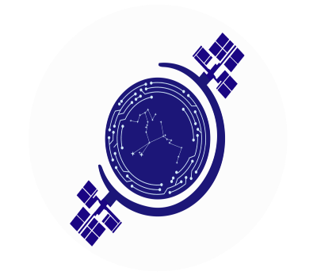

***Original code can be found in https://github.com/MANRAF04/web-gcs***

# Web-Based Ground Control Station (Web-GCS) for ArduPilot SITL 🛰️




**Developed with passion by StarBound – University of Thessaly Student Team, Volos, Greece.** 🇬🇷

This project is a web-based application designed to act as a simple Ground Control Station (GCS) for controlling ArduPilot vehicles running in the Software-In-The-Loop (SITL) simulator. It provides a user-friendly interface accessible from a web browser to monitor telemetry and send basic commands locally.

## ✨ Features

* **Connect/Disconnect:** Establish and close connection to a running ArduPilot SITL instance via UDP.
* **Real-time Telemetry (Basic):** Displays key vehicle information like:
    * Connection Status
    * Current Mode
    * Armed State
    * Latitude, Longitude, Altitude
    * Airspeed, Groundspeed, Heading
    * Battery Voltage (if available)
* **Commands:** Takeoff (to the altitude in the input box) and Return to Launch.
* **Interactive map** (Leaflet.js) showing the vehicle position and flight trail.
* **Right-click map menu:** Go to a point, Add / Clear waypoints, Return to home (the plane circles above it), Land here.
* **Workshop buttons:** every `@button("...")` function in `backend/workshop.py` gets a button in the top bar, plus **Stop**. One runs at a time.
* **Landmarks** on the map, each with its photo zone shaded.
* **Workshop exercises:** filled in during the workshop in `backend/workshop.py`, following `CHEATSHEET.md`. Ready-made helpers (measuring, landmarks, photos, buttons) are in `backend/game.py`.

## 💻 Tech Stack

* **Backend:** Python 3, Flask, DroneKit, pymavlink
* **Frontend:** HTML5, CSS3, Vanilla JavaScript (initially)
* **Communication:** REST API (Flask) & Polling (initial telemetry), WebSockets (planned)
* **Simulation:** ArduPilot SITL

## 🔧 Prerequisites

Before you begin, ensure you have the following installed on your system (tested on Kali Linux):

1.  **Git:** For cloning the repository (`sudo apt update && sudo apt install git -y`).
2.  **Python 3:** (Version 3.8+ recommended) and `pip` (`sudo apt install python3 python3-pip -y`).
3.  **Python Virtual Environment:** (`sudo apt install python3-venv -y` or usually included with Python).
4.  **ArduPilot SITL (only without a game server):** at the workshop the game server gives you a plane. To fly without one, you need your own SITL: see the [main README](../README.md#fallback-running-your-own-plane-sitl).
5.  **(Optional but Recommended):** Node.js and npm for potential future frontend development (`sudo apt install nodejs npm -y` or preferably use [NVM](https://github.com/nvm-sh/nvm)).

## 🚀 Getting Started

Follow these steps to set up and run the Web-GCS project locally.

### 1. Clone the Repository

```bash
git clone https://github.com/starbound-team/ardupilot-workshop.git
cd ardupilot-workshop/web-gcs
```

### 2. Setup Backend

```bash
# Navigate to the backend directory
cd backend

# Create a Python virtual environment
python3 -m venv venv

# Activate the virtual environment
# On Linux/macOS:
source venv/bin/activate
# On Windows:
# .\venv\Scripts\activate

# Install required Python packages
pip install -r requirements.txt

# Go back to the root directory (optional, for next steps)
cd ..
```

### 3. Setup Frontend
The frontend is plain HTML, CSS and JavaScript in `frontend/`, served by the backend itself. No build step, nothing to install.

## ▶️ Running the Application

You need **two** terminal windows: one for SITL and one for the backend. With a game server (`GAME_SERVER_URL` in `workshop.py`) the plane runs on the organisers' laptop, so skip step 1 and use one.

1.  **Start ArduPilot SITL** (only without a game server)
    * Open a **new terminal** and start SITL, either inside the Docker container or from a native ArduPilot checkout (see the [main README](../README.md)). Both commands start the plane at the workshop field in Volos.

        Docker or native:
        ```bash
        sim_vehicle.py -v plane -l 39.360886,22.945749,0,0 --console --map
        ```
    * Wait for SITL to initialize completely (you should see GPS coordinates appearing). **Leave this terminal running.**

2.  **Start the Backend Server**
    * Open a terminal in the project's backend directory: `cd ardupilot-workshop/web-gcs/backend`

    * Run the Flask application with the virtual environment's Python:
    ```bash
    venv/bin/python app.py          # Linux
    venv\Scripts\python app.py      # Windows
    ```

    * It serves the GCS on `http://localhost:5000`. **Leave this terminal running.**

3. **Access the Web GCS**

    Open your web browser (e.g., Firefox, Chrome).
    Navigate to `http://localhost:5000`.

## 🕹️ Usage

1.  Ensure the backend is running (and SITL, without a game server).
2.  Click the **"Connect to SITL"** button in the web interface.
3.  Observe the **Status** section update. If successful, telemetry data should start appearing.
4.  Use the **"Get Status"** button to manually refresh telemetry (it also polls automatically).
5.  Use the **"Disconnect"** button to close the connection to the vehicle.
6.  Use **Takeoff** to arm and climb, then right-click the map for Go-to, waypoints, RTL and Land here, and use the workshop buttons in the top bar. A plane can't stop in the air: RTL and Go-to make it circle above the point until you send something else.

> **Note:** the backend runs in Flask debug mode, so it restarts automatically every time you save `workshop.py`. The restart drops the vehicle connection, and the page reconnects by itself (it tells a restart from a lost plane by an id that is new on every start). If `workshop.py` has a mistake, the backend keeps running without the plane, the page shows the line, and the save that fixes it reconnects.

## 📽️ Game server and live map

The organisers' laptop runs the game: rounds, landmarks, photos and money. It also shows a full screen map for the projector with every participant's plane, the public landmarks and the leaderboard. The workshop works without it: without a server address, everyone practises on landmarks of their own.

**On the laptop at the front** (needs Flask, e.g. from the backend's venv):
```bash
cd ardupilot-workshop/web-gcs/live-map
python server.py
```
It prints three addresses: open the `localhost` one on the projector (F11 for full screen), keep the `organiser` one (it has a key in it) for starting rounds, and write the last one on the board. Participants' laptops must be on the same network, and the laptop's firewall must allow port 8080.

**On every participant's laptop**, at the top of `backend/workshop.py`:
```python
PILOT_NAME = "Maria"
GAME_SERVER_URL = "http://192.168.1.50:8080"   # the address from the board
```
After saving, click **Connect**. The GCS asks the server for a plane (the first time it waits while one starts, then the plane stays theirs), sends its position twice per second and gets the game back. Without a server, or if the server has no plane for them, the GCS uses their own SITL. `SITL_ADDRESS` in `workshop.py` overrides all of that with a fixed plane address (for testing).

**Hosting the planes** (so participants don't need ArduPilot installed): on every laptop that should host planes, the server's included, with ArduPilot's plane built:
```bash
python live-map/sitl_agent.py http://192.168.1.50:8080 --key KEY --max 15
```
`KEY` is the organiser key the server printed; `--max` is how many planes that laptop may run (one plane ≈ 5% of a CPU core and 9 MB; MAVLink ≈ 4 KB/s per plane over the network). The agent checks in with the server every second and starts planes when the server asks; the server gives each new player a plane on the laptop with the most room. A plane that stops is started again; Ctrl+C stops that laptop's planes. The organiser page lists every laptop and plane. Agents start planes directly, not with `sim_vehicle.py`, which would kill all the others (so don't run `sim_vehicle.py` on a hosting laptop either).

**Running a round** (organiser page): set the minutes, the countdown and the landmark seed, then **Start test round** or **Start real round**. During the countdown every plane is put down at its start position near a corner of the area (a reboot of its SITL; a SITL started with `sim_vehicle.py` can't be moved, so that plane flies there once it's in the air); players take off again themselves. Photographing a landmark first can make the next one appear, known only to the photographer for a short head start (sometimes two, the second public to everyone). The area where landmarks appear shrinks over the round: its end size and Hold are on the organiser page. **Stop round** ends it early; **Reset** goes back to practice. The rules' numbers are in `RULES` at the top of `live-map/contest.py`.

**Useful while running it:**
* On the map: `F` fits all drones on screen, `T` shows/hides the trails. A drone that stops reporting fades out after 5 seconds.
* Clear the map between rounds: `curl -X POST http://localhost:8080/api/reset`
* Test the map without SITL: `python fake_drones.py 6` sends 6 made-up drones flying in circles.

**Planning the challenge:** `http://localhost:8080/planner` is a map for placing the landmarks and the angles they must be seen from. It shows a draggable test drone and every live drone with its view cone, and turns a zone green while a drone sees the landmark from it. The plan saves in the browser and downloads as JSON.
